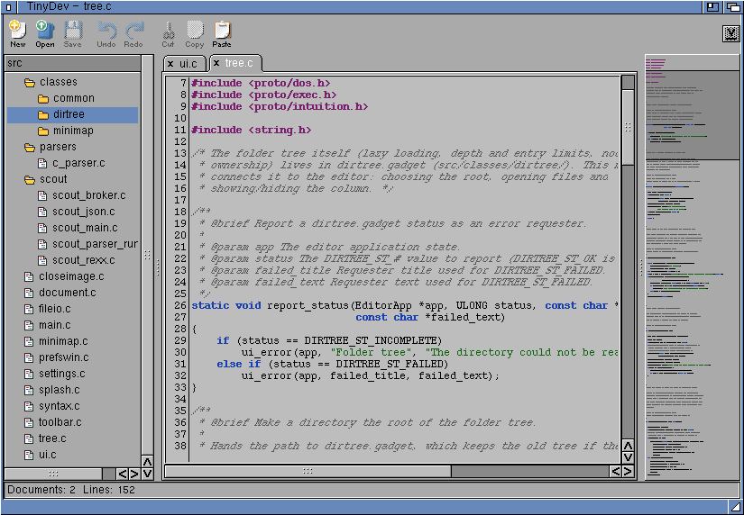
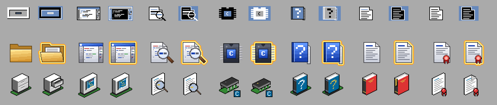

# TinyDev

TinyDev is a compact native text editor for programmers on AmigaOS 3.2,
built with ReAction. It runs on a 68000, but is meant for a 68030 or
faster.

In the future, TinyDev aims to be a simple but complete development environment
for AmigaOS 3.2.
It should support multiple languages via AmigaOS catalogues,
and multiple syntax parsers. It will also include features such as template system,
running build tools, and other external tools.

As you can guess, most of the code is AI-generated (using different models at the beginning;
now Claude Opus 5.5 only). I will try to manually check and improve the generated code.

## Features

- Several documents in tabs, each a `texteditor.gadget`: selection,
  clipboard, undo/redo, line numbers, horizontal scrolling without line
  wrapping. LF, CR and CRLF line endings are kept; saving goes through a
  temporary file, so a failed save does not destroy the original.
- Syntax highlighting with the rules of TinyDev-Scout's parsers (C:
  `.c`, `.h`), including the types, functions, macros and constants of
  the project; without Scout, built-in highlighting of C and AmigaDOS
  scripts (`.script`, `.dos`). Other files are plain text.
- Folder tree of the project (the directory opened with Project/Open
  Directory): opens files with a double-click and follows changes on disk.
- Minimap: a coloured overview of the document; click or drag in it to
  scroll.
- Find and replace (Amiga+F) in the current document, in all open documents
  or in all files of the project, as plain text or with regular expressions.
- Bookmarks (Amiga+B, Amiga+J, Amiga+K, or a click into the editor's left
  bar), saved per project, and a bookmark list (View/Bookmarks).
- Symbol list (View/Symbol List): the functions, types, macros and
  variables of the current file or of the project, found by TinyDev-Scout,
  with a filter; a double-click goes to the symbol.
- Problems found by TinyDev-Scout (syntax errors and the like) marked in
  the bar left of the text, shown in the status line on their line, and
  listed in a problem list (View/Problem List).
- Go to Definition (Amiga+T) jumps to where the name at the cursor is
  defined, also in another file; Go Back (Amiga+U) returns.
- Completion (Amiga+L): a list of the names that could complete the word
  at the cursor (locals, the file's and the project's symbols, keywords).
- Project settings (Build/Project Settings...): Shell commands for
  building, running and debugging the project, several per action with
  one default. Build (Amiga+E) saves the modified documents and runs in
  the background, its output in the output window (View/Output Window);
  Run (Amiga+R) and
  Debug (Amiga+D) start in a console window of their own; all three are
  also in the toolbar.
- Toolbar with AISS images, images and text, or text only; a settings
  window for window, colours and toolbar.
- English and German texts (catalogs), help pages shown by the HelpViewer
  (Project/Help..., see below).
- TinyDev-Scout: a commodity with an ARexx port for source analysis (see
  below); TinyDev starts it and has it analyse the project and the open
  documents (the status line shows their symbols and problems).
- Temporary files (Scout's copies of changed documents, the Build menu's
  scripts) in a drawer of your choice, `T:` by default.

## Requirements

- AmigaOS 3.2 (ReAction classes V47).
- `dirtree.gadget` and `minimap.gadget`, TinyDev's own classes: installed in
  `SYS:Classes/Gadgets/` or next to TinyDev in `Classes/Gadgets/`.
- AISS (`TBImages:`) for the toolbar images; without them the buttons show
  text.
- For the help: html.gadget from the
  [HTML gadget](https://github.com/andregewert/Amiga-HTML-Gadget) project.

## Usage

    TinyDev [<file> ...]

From the Workbench, TinyDev opens the files given as project icons.

| Key | Command |
|---|---|
| Amiga+N, O, S, W, Q | New, Open, Save, Close, Quit |
| Amiga+Z, Y, X, C, V, A | Undo, Redo, Cut, Copy, Paste, Select All |
| Amiga+F, G | Find and replace, Find Next |
| Amiga+T, U | Go to the definition of the name at the cursor (again: the next one), go back |
| Amiga+L | Complete the word at the cursor (a list of names from TinyDev-Scout) |
| Ctrl+left Alt | Rectangular selection on/off (texteditor.gadget; fixed-width font only; shown in the status line) |
| Amiga+B, J, K | Set/remove bookmark, next and previous bookmark |
| Amiga+E, R, D | Build project, Run, Debug (the default commands of the project settings) |
| Amiga+, | Settings |
| Amiga+? | About |
| Amiga+I | Iconify (also the window's iconify gadget); open tool windows come back with the window |

### Regular expressions

The find window understands POSIX extended regular expressions (for example
`[[:digit:]]+` instead of `\d+`; no lazy quantifiers or lookaround). `^` and
`$` match at the start and end of a line, a match never spans a line break.
In the replacement, `\0` inserts the whole match, `\1` to `\9` its groups and
`\\` a backslash. Character classes and case folding include the Latin-1
letters (Ä, ß ...).

### Bookmarks file

The bookmarks of a project are kept in `.tinydev/bookmarks.json` in the
project directory, a file you may edit by hand (JSON, ISO-8859-1; `line`
counts from 1, `text` finds the line again after changes outside TinyDev):

    {
      "version": 1,
      "bookmarks": [
        { "file": "src/ui.c", "line": 99, "text": "void tree_handle_event(EditorApp *app)" }
      ]
    }

### Project file

The project settings are kept in `.tinydev/project.json` in the project
directory, a file you may edit by hand and keep with the project (JSON,
ISO-8859-1). Each action has a list of commands; `command` is a Shell
command line or a list of lines run as a script, `name` and `dir` (relative
to the project) are optional, `default` marks the command the action runs.
`include` lists drawers with headers (relative to the project or absolute,
e.g. the NDK's) that TinyDev-Scout indexes for Go to Definition and
completion. `{file}`, `{base}` (without extension) and `{project}` are
replaced with the active document and the project directory:

    {
      "version": 1,
      "build": [
        { "name": "Build", "command": "make", "default": true },
        { "name": "Clean", "command": ["Delete build ALL QUIET", "Delete bin/TinyDev QUIET"] }
      ],
      "run": [ { "command": "TinyDev", "dir": "bin" } ],
      "debug": []
    }

### Settings (tool types)

Settings are tool types of the program icon, also when TinyDev is started
from the Shell. Project/Settings... changes them; "Save" writes them into
the icon, "Use" keeps them for this session.

| Tool type | Meaning |
|---|---|
| `TOOLBAR=IMAGES\|BOTH\|TEXT` | Toolbar buttons show images (default), images with text below, or text only |
| `TOOLBARFRAMES` | Frames around the toolbar buttons |
| `NOSPLASH` | No splash window while TinyDev starts |
| `NOFOLDERTREE`, `NOLINENUMBERS`, `MINIMAP` | View at the start: without the folder tree, without line numbers, with the minimap (the View menu changes the view of the session only) |
| `WIDTH=n`, `HEIGHT=n` | Size of the main window (default: 90 % x 80 % of the screen) |
| `LEFT=n`, `TOP=n` | Position of the main window (default: centred) |
| `BOOKMARKLIST` | Open the bookmark list at the start |
| `BOOKMARKWINDOW=l,t,w,h` | Position and size of the bookmark list |
| `SYMBOLLIST` | Open the symbol list at the start |
| `SYMBOLWINDOW=l,t,w,h` | Position and size of the symbol list |
| `PROBLEMLIST` | Open the problem list at the start |
| `PROBLEMWINDOW=l,t,w,h` | Position and size of the problem list (otherwise below the main window) |
| `OUTPUT` | Open the output window at the start |
| `OUTPUTWINDOW=l,t,w,h` | Position and size of the output window (otherwise below the main window) |
| `NOSCOUT` | No source analysis with TinyDev-Scout |
| `TEMPDIR=drawer` | Drawer for temporary files (default `T:`) |
| `COLOR_TEXT`, `COLOR_KEYWORD`, `COLOR_STRING`, `COLOR_COMMENT`, `COLOR_PREPROCESSOR`, `COLOR_TYPE`, `COLOR_FUNCTION`, `COLOR_MACRO`, `COLOR_CONSTANT` | Colours of the syntax highlighting as `RRGGBB` |

View/Snapshot Tool Windows writes `BOOKMARKLIST`, `BOOKMARKWINDOW`,
`SYMBOLLIST`, `SYMBOLWINDOW`, `PROBLEMLIST`, `PROBLEMWINDOW`, `OUTPUT` and
`OUTPUTWINDOW`.

### Limits

- Text is 8-bit (ISO-8859-1); there is no UTF-8 decoding.
- The editor uses the screen's default font; there is no font selection.
- The editor's text area keeps the Workbench background colour (a limit of
  `texteditor.gadget` on OS 3.2).
- The folder tree shows at most 16 directory levels and 2048 entries.

## HelpViewer

`HelpViewer` shows a directory of HTML help pages: the pages by their
titles in a tree on the left, the page on the right, with Home, Back and
Forward; Project/Print prints the page, also as PostScript or PDF. TinyDev
uses it for its own help, but it works with any directory of HTML pages.

    HelpViewer [DIR] <directory or page> [TTF] [FONTSET Vera|DejaVu|Noto] [SIZE n]
               [PORTNAME <name>]

| Option / tool type | Meaning |
|---|---|
| `DIR` | Directory or page to show; without it, a welcome text |
| `TTF` | Use htmlttf.gadget (TrueType fonts) instead of html.gadget |
| `FONTSET`, `SIZE` | Font family and text size for `TTF` |
| `PORTNAME` | Only one viewer per name: a later start with the same name shows its page in the running viewer |
| `WINDOW=l,t,w,h` | Window position and size (tool type, written by Project/Snapshot Window) |
| `PRINT_MODE=PRINTER\|PS\|PDF`, `PS_LEVEL=1\|2`, `PRINT_TO=FILE\|PRT\|PS\|DEVICE`, `PRINT_DEVICE`, `PRINT_IMAGEDPI` | Print options: kind of output, PostScript level and destination, picture resolution (tool types, written by the print window) |
| `PAPER=A4\|A5\|LETTER\|LEGAL`, `MARGINS=l,t,r,b`, `PRINT_SERIF`, `PRINT_SIZE`, `NOPAGENUMBERS`, `NOPRINTBACKGROUNDS` | Page options: paper, margins in mm, font and size for PostScript/PDF, footer, background colours |

- The tree lists the HTML files of the directory in natural order of their
  names (`2-...` before `10-...`); a drawer is shown by the title of its
  `index.html`. The `index.html` of the directory itself is the home page,
  its title the header of the tree.
- A help directory may hold one drawer per language, named like the Amiga
  locales (`english`, `deutsch` ...); the viewer opens the one of your
  language.
- Links between the pages are followed; links to the web are only shown in
  the status line.
- Project/Iconify (Amiga+I) or the iconify gadget puts the viewer on the
  Workbench as its icon, titled with the help's home page; a later start
  with the same `PORTNAME` opens it again.
- Printing needs html.gadget 1.2. It prints to the default printer as
  graphics, or writes PostScript (to a file, `PRT:`, TurboPrint's `PS:` or
  a device) or PDF; with TurboPrint only through PostScript.

`src/helpviewer/sample/` is a small help directory to try it with.

## TinyDev-Scout

`TinyDev-Scout` is a commodity that analyses source code for editors. It
runs language parsers, small standalone programs (one per language, in
`Parsers/`), keeps their results and answers questions through its ARexx
port `TINYDEV_SCOUT`, in JSON: symbols, diagnostics, "go to definition",
completion and highlighting. Its ideas come from the Language Server
Protocol, but it is not LSP.

Tool types of its icon (or Shell arguments of the same names):

| Tool type | Default | Meaning |
|---|---|---|
| `TEMPDIR` | `T:` | drawer for temporary files |
| `PARSERS` | `PROGDIR:Parsers` | drawer of the parsers |
| `TIMEOUT` | `10` | seconds a parser may take per file |
| `MINFREE` | `1024` | free memory (KB) below which idle sessions are closed, 0: never |
| `CX_POPKEY` | `ctrl alt s` | hotkey that shows Scout's window |
| `CX_POPUP` | `NO` | `YES` shows the window at the start |
| `CX_PRIORITY` | `0` | commodity priority |

`scripts/tdscout_query.rexx` sends a command and shows the result, e.g.
`rx scripts/tdscout_query.rexx STATUS`; `rx scripts/test_scout.rexx` tests
the commands with the sample sources of `tests/data/c_parser/` (it starts
`bin/TinyDev-Scout` if needed).

TinyDev starts Scout (from its own drawer) when it needs it, opens a
session for the project and has the open documents analysed (status
line, symbol list, problems). Scout notices files of the project that
change on disk. Its window (Exchange's Show, or its hotkey) shows what
it does, its sessions and parsers. Its design, the
ARexx commands and the protocol for writing parsers are described in
[src/scout/docs/Scout.md](src/scout/docs/Scout.md) and
[src/scout/docs/Scout-Protocol.md](src/scout/docs/Scout-Protocol.md).

## Building

The shared tools in `amiga-devkit/` are a git submodule
([Amiga-Devkit](https://github.com/andregewert/Amiga-Devkit)), and so are
Henry Spencer's regex library (`external/regex/`) and the headers of
html.gadget (`external/html_gadget/`). Clone with `git clone --recursive` or
run `git submodule update --init` once. The toolchain is bebbo's amiga-gcc
in `/opt/amiga`.

    make            # programs, classes, catalogs and help pages in bin/
    make test       # host tests
    make docs       # HTML documentation of the sources (Doxygen) in build/docs/
    make dist       # Aminet archive dist/TinyDev.lha
    make icons      # sample icons in icons/

`bin/` is laid out as on the Amiga and can be used from there; everything
else the build makes goes to `build/`. Technical notes for developers are
in `TECHNICAL.md`, the conventions in `AGENTS.md`.

## Gadget classes

TinyDev's own ReAction classes are standalone class libraries, usable by
other programs as well. Their interface is documented in
`include/gadgets/<name>.h` (`make docs-dirtree`, `make docs-minimap`).

| Class | Superclass | Purpose |
|---|---|---|
| `dirtree.gadget` | `listbrowser.gadget` | Lazily loaded directory tree with entry symbols; follows changes on disk; file and exclude patterns, shown names from a hook, natural order |
| `minimap.gadget` | `gadgetclass` | Scaled, coloured overview of a `texteditor.gadget`, rendered in its own process |

## Icons

`make icons` draws sample Workbench icons in three styles (classic 4 colour,
GlowIcons, NewIcons) into `icons/<Style>/` and a preview `icons/preview.png`.
The motifs are in `tools/mkicons.py`, the icon writer comes from
`amiga-devkit/tools/amigaicons.py`:

| Icon | Motif |
|---|---|
| `TinyDev` | Editor window with line numbers, coloured code and the minimap |
| `TinyDev-Scout` | A page of code under a magnifying glass |
| `c_parser` | A chip with the label of the parser's language ("C") |
| `HelpViewer` | A blue handbook with a question mark on its cover |

## Languages

TinyDev speaks English (built in) and German (`Catalogs/deutsch`). A new
translation is a `.ct` file for `catalogs/TinyDev.cd` (and
`src/helpviewer/catalogs/HelpViewer.cd`), as for CatComp or FlexCat; its
help pages go to `package/help/<language>/`.

## Credits

Regular expressions: the regex library by Henry Spencer (alpha3.8 patch 1,
<https://github.com/garyhouston/regex>), Copyright 1992, 1993, 1994, 1997
Henry Spencer, used unchanged as a submodule.
