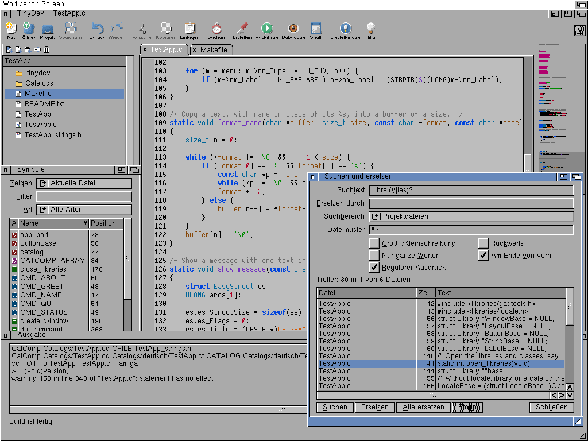
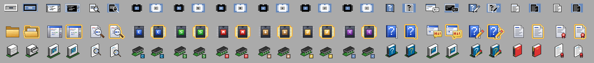

# 

TinyDev is a compact native text editor for programmers on AmigaOS 3.2,
built with ReAction. It runs on a 68000, but is meant for a 68030 or
faster.

TinyDev is meant to be run on real hardware, not only in emulators and on PiStorm machines.
Benchmark is my good old Amiga 2000, equipped with a TF356 (68030, 64MB RAM) and a GBAPII++.

In the future, TinyDev aims to be a simple but complete development environment
for AmigaOS 3.2. It supports multiple programming languages through a simple
extendable JSON-based protocol. External build tools (like `make` or `smake`) can
be integrated through configurable commands.

The user interface supports localization via AmigaOS catalogs. Currently, next to
built-in English texts, a German catalog is included.

As you can guess, most of the code is AI-generated (using different models at the beginning;
now Claude Opus 5.5 only). I will try to manually check and improve the generated code.

## Features

- ReAction-based user interface with support for translations  
- Settings per file type
- Integrated directory browser
- Minimap: a coloured overview of the document; click or drag in it to
  scroll.
- Simple project management
- File and project templates
- Syntax highlighting for various languages
- Bookmark management
- Static source code analysis
- Symbol list
- Auto-completion based on the symbols found  
(**not** a simple keyword list)
- Find and replace (Amiga+F) in multiple documents; supports regular expressions
- Integrated documentation (work in progress)
    - The `HelpViewer` is a simple but functional tool for displaying the
      supplied documentation
    - `TinyDev` includes a project template and all the tools needed to
      create and edit your own help pages
- Extensibility without changing `TinyDev`:
    - You can add your own templates
    - You can add your own source code parsers
- Reusable components:
    - The ReAction classes `dirtree` and `minimap` can be used in your own
      ReAction applications
    - The source code analysis tools (Scout) are designed so that they can
      be integrated into your own applications through a simple protocol
      (ARexx and JSON)
    - The `HelpViewer` is designed as a general-purpose tool. Its license
      allows it to be embedded in other projects

## Requirements

- AmigaOS 3.2 (ReAction classes V47).
- `dirtree.gadget` and `minimap.gadget` (included)
- AISS (`TBImages:`) for the toolbar images; without them the buttons show
  text.
- For the help: html.gadget from the
  [HTML gadget](https://github.com/andregewert/Amiga-HTML-Gadget) project.
- Optional: [openurl.library](https://github.com/jens-maus/libopenurl), for
  opening web links of the help in a browser.

## Installation

Double-click `Install` in the archive. Everything goes into one drawer, so
deleting the drawer removes TinyDev; for an update, choose the same place
again and your settings stay. TinyDev also runs directly from the archive.

## Regular expressions

The find window understands POSIX extended regular expressions (for example
`[[:digit:]]+` instead of `\d+`; no lazy quantifiers or lookaround). `^` and
`$` match at the start and end of a line, a match never spans a line break.
In the replacement, `\0` inserts the whole match, `\1` to `\9` its groups and
`\\` a backslash. Character classes and case folding include the Latin-1
letters (Ä, ß ...).

## Limits

- Text is 8-bit (ISO-8859-1); there is no UTF-8 decoding.
- The editor uses the screen's default font; there is no font selection.
- The editor's text area keeps the Workbench background colour (a limit of
  `texteditor.gadget` on OS 3.2).
- The folder tree shows at most 16 directory levels and 2048 entries.

## HelpViewer

`HelpViewer` shows a directory of HTML help pages. Help pages can be converted from
markdown files with `mdtohtml` (included). `TinyDev` includes a project template
for creating help pages.

## TinyDev-Scout

`TinyDev-Scout` is a commodity that analyses source code for editors. It
runs language parsers, small standalone programs (one per language, in
`Parsers/`), keeps their results and answers questions through its ARexx
port `TINYDEV_SCOUT`: symbols, diagnostics, "go to definition",
completion and highlighting. Its ideas come from the Language Server
Protocol, but it is not LSP.

For more details see: [src/scout/docs/Scout.md](src/scout/docs/Scout.md).

## Sprout

`Sprout` creates projects and files from a template. It includes mechanisms
for replacing user defined variables and for optional file creation.
Templates can be packed into a LhA archive.

The template format is described in
[src/sprout/docs/Sprout.md](src/sprout/docs/Sprout.md).

## Building

The shared tools in `amiga-devkit/` are a git submodule
([Amiga-Devkit](https://github.com/andregewert/Amiga-Devkit)), and so are
Henry Spencer's regex library (`external/regex/`), the headers of
html.gadget (`external/html_gadget/`) and of OpenURL (`external/openurl/`)
and the Kickdown project for `mdtohtml` (`external/mdtools/`). Clone with `git clone --recursive` or run
`git submodule update --init --recursive` once. The toolchain is bebbo's amiga-gcc
in `/opt/amiga`.

    make            # programs, classes, catalogs and help pages in bin/
    make test       # host tests
    make docs       # HTML documentation of the sources (Doxygen) in build/docs/
    make dist       # Aminet archive dist/TinyDev.lha
    make icons      # sample icons in icons/

`bin/` is laid out as on the Amiga and can be used from there; everything
else the build makes goes to `build/`. Technical notes for developers are
in `TECHNICAL.md`, the conventions in `AGENTS.md`.

## Gadget classes

TinyDev's own ReAction classes are standalone class libraries, usable by
other programs as well. Their interface is documented in
`include/gadgets/<name>.h` (`make docs-dirtree`, `make docs-minimap`).

| Class | Superclass | Purpose |
|---|---|---|
| `dirtree.gadget` | `listbrowser.gadget` | Lazily loaded directory tree with entry symbols; follows changes on disk; file and exclude patterns, shown names from a hook, natural order |
| `minimap.gadget` | `gadgetclass` | Scaled, coloured overview of a `texteditor.gadget`, rendered in its own process |

## Icons

`make icons` draws sample Workbench icons in three styles (classic 4 colour,
GlowIcons, NewIcons) into `icons/<Style>/` and a preview `icons/preview.png`.
The motifs are in `tools/mkicons.py`, the icon writer comes from
`amiga-devkit/tools/amigaicons.py`:

The installer lets you choose which icons will be installed.

## Languages

TinyDev speaks English (built in) and German (`Catalogs/deutsch`). A new
translation is a `.ct` file for `catalogs/TinyDev.cd` (and
`src/helpviewer/catalogs/HelpViewer.cd`), as for CatComp or FlexCat; its
help pages go to `package/help/<language>/`.

## Credits

Regular expressions: the regex library by Henry Spencer (alpha3.8 patch 1,
<https://github.com/garyhouston/regex>), Copyright 1992, 1993, 1994, 1997
Henry Spencer, used unchanged as a submodule.

Web links of the help: the headers of
[openurl.library](https://github.com/jens-maus/libopenurl), used unchanged
as a submodule; the library is installed separately.

Markdown: `mdtohtml` from [Kickdown](https://github.com/andregewert/Amiga-Kickdown)
with [md4c](https://github.com/mity/md4c) (MIT License), used unchanged as a submodule.

Font: Holstein is derived from [DejaVu Sans Mono](https://dejavu-fonts.github.io/)
(Bitstream Vera Sans Mono with the DejaVu changes), rendered as a bitmap and
redrawn in parts by hand; licence in `fonts/Holstein/LICENSE`.
